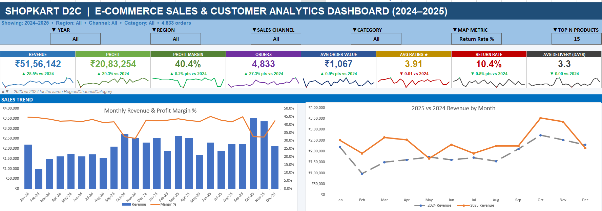
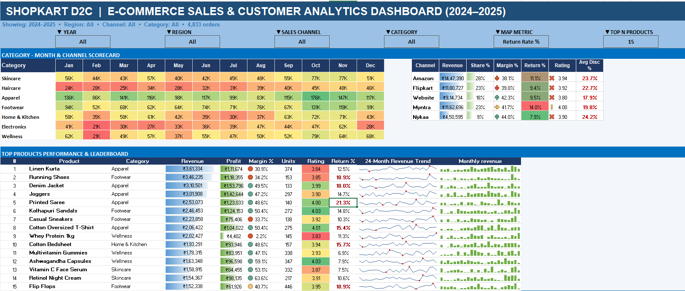

# 🛒 ShopKart D2C | E-Commerce Sales & Customer Analytics Dashboard (2024–2025)

  
  
  

A premium e-commerce analytics project built in Microsoft Excel to transform raw sales data into a business-ready decision dashboard. This project focuses on understanding revenue generation, channel performance, customer retention, product contribution, and operational efficiency for a direct-to-consumer retail brand.

---

## Project Summary & Objective
ShopKart is a D2C brand operating across multiple sales channels, including Amazon, Flipkart, Myntra, Nykaa, and its own website. The goal of this project was to analyze how well the business is performing across different sales environments and identify the drivers of growth, efficiency, and profitability.

The primary objective was to build a clear, interactive dashboard that helps interpret business performance across:
- sales channels
- product categories
- customer behavior
- regional demand
- monthly revenue trends
- return and delivery-related issues

This project was designed to answer practical business questions such as:
- Which sales channels are generating the most revenue and profit?
- Which product categories are performing best?
- Which regions and markets are most valuable?
- Are customers returning for repeat purchases?
- How does return rate affect business efficiency?
- Which products should receive more investment or promotion?

---

## Analysis & Business Problem Solved
Retail businesses often have rich sales data but limited visibility into how performance changes across channels, products, and regions. Without a unified analytical view, decision-makers struggle to:
- compare channels fairly
- assess product profitability
- identify regional opportunities
- detect operational issues such as high return rates
- monitor customer retention and loyalty
- understand whether sales growth is sustainable

To address this, I analyzed multiple dimensions of the business:
- Sales channel performance
- Product and category contribution
- Regional demand and market share
- Customer retention and repeat purchase behavior
- Return rate and delivery efficiency
- Monthly revenue and growth trends

This analysis transformed raw e-commerce data into a structured and visual dashboard that gives a single platform for evaluating business health, identifying trends, and supporting strategic decisions.

---

## Tools & Technologies Used
This project was built using Microsoft Excel and a strong combination of business intelligence and reporting tools available inside the software.

### 1. Microsoft Excel
Excel served as the core platform for this project. It was used to structure, clean, and organize the raw data while also serving as the primary environment for dashboard creation and reporting.

### 2. Power Query
Power Query was used to clean and transform the data before analysis. This helped structure the dataset and improve reliability for the final report.

### 3. Pivot Tables
Pivot tables were used to summarize large data sets efficiently, enabling comparisons across channel, category, region, and time dimensions.

### 4. Excel Formulas and Functions
I used formulas for lookup, aggregation, conditional logic, date-based calculations, and performance metrics such as revenue, profit margin, return rate, and delivery time.

### 5. Data Cleaning and Transformation
Before analysis, the dataset was cleaned to ensure consistency in dates, regions, product categories, sales values, return numbers, and order volumes.

### 6. Dashboard Design
The dashboard was designed to be visually effective and executive-friendly, making it easy for decision-makers to understand trends and performance without reading raw data.

### 7. KPI Scorecards
The project includes KPI scorecards for revenue, profit, profit margin, average order value, return rate, and delivery speed to provide a quick summary of performance.

### 8. Business Analytics & Data Visualization
The project uses charts, trends, and summary cards to turn numbers into business insight and communicate performance clearly.

---

## Key Insights & KPI Coverage
This project surfaced several important business insights:

- Amazon and Flipkart are among the strongest revenue contributors in the retail ecosystem.
- Apparel and footwear dominate the sales mix and contribute significantly to total revenue.
- North and South regions appear to be the most productive markets.
- Return rate and delivery timing strongly affect customer experience and operational efficiency.
- Products with strong margins and repeat demand represent strategic growth opportunities.
- Monthly revenue patterns reveal seasonality and trend variations that can guide planning and inventory decisions.

### KPI Coverage
The dashboard includes a comprehensive set of performance measures:

| KPI Category | Description | Business Value |
|---|---|---|
| Revenue | Total sales generated across channels and time | Measures top-line growth |
| Profit | Net earnings after costs | Evaluates business efficiency |
| Profit Margin | Profit as a percentage of revenue | Shows pricing and cost effectiveness |
| Orders | Total completed orders | Indicates demand volume |
| Average Order Value | Average value per order | Supports customer value analysis |
| Return Rate | Percentage of orders returned | Highlights product or service quality risk |
| Average Delivery Time | Average time to deliver | Reflects operational performance |
| Regional Contribution | Performance by region | Helps identify geography-driven opportunities |
| Product Leaderboard | Top-performing products | Guides product strategy and merchandising |

---

## Dashboard Preview

### Main Dashboard

### Analytics Overview

---

## Skills Demonstrated
This project demonstrates practical capability in:

- Microsoft Excel
- Data Cleaning and Preparation
- Data Analysis
- Dashboard Design
- Business Intelligence
- Sales Performance Analysis
- Retail Analytics
- KPI Design and Reporting
- Regional Market Analysis
- Product Performance Evaluation
- Customer Retention Analysis
- Operational Analytics

These skills are directly relevant to roles in analytics, reporting, business intelligence, and e-commerce operations.

---

## Final Summary / Conclusion
This project reflects my ability to take raw business data and turn it into a meaningful, executive-friendly dashboard. It goes beyond simply organizing numbers — it tells a story about business performance, identifies key trends, and supports better decisions.

From a recruiter’s perspective, this project demonstrates:
- analytical thinking
- business awareness
- dashboard expertise
- data storytelling
- practical reporting skills
- ability to interpret performance metrics

It is a strong example of how Excel can be used as a powerful analytics tool for real-world business decision making.

---

## Connect
- LinkedIn: https://www.linkedin.com/in/lakshay-aggarwal-130a33236/
- Email: lakshay.aggar@gmail.com
- GitHub: https://github.com/345lakshayaggarwal-prog

  <strong>Built for business impact. Designed to stand out.</strong>

