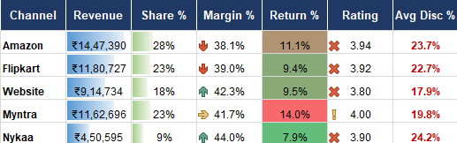
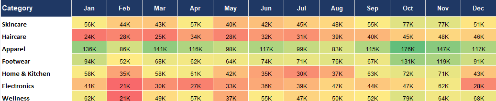
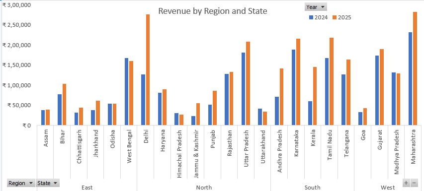

# 🛒 ShopKart D2C — E-Commerce Sales & Customer Analytics (2024–2025)

An executive-grade retail analytics dashboard and relational data model built in Microsoft Excel. This project evaluates multi-channel sales performance, customer retention dynamics, regional fulfillment efficiency, and marketing spend efficiency across 4,800+ transactions spanning 2024–2025.
---
## 📌 Business Overview & Objectives
ShopKart is a direct-to-consumer (D2C) brand retailing across multi-channel marketplaces (**Amazon, Flipkart, Myntra, Nykaa**, and direct **Website**). 

### Key Business Challenges Addressed:
1. **Channel & Category Profitability**: Identifying which sales channels deliver sustainable operating margins after factoring discounts, COGS, and return shipping costs.
2. **Customer Retention**: Tracking repeat vs. first-time buyer acquisition trends over 24 continuous months.
3. **Logistics & Delivery Operations**: Assessing fulfillment speed benchmarks ($\le$2 days vs. 5+ days) and their impact on product return rates.
4. **Marketing Spend Efficiency**: Measuring regional advertising spend ROI and correlation to net state revenue.
---
## 🛠️ Technical Stack & Excel Features Applied
* **Advanced Lookups & Data Modeling**:
  * Multi-criteria aggregation via `SUMIFS`, `COUNTIFS`, `AVERAGEIFS`.
  * Normalized data structuring using `INDEX/MATCH` across dimensional tables (`Products`, `State`, `Market`).
  * Dynamic timeline logic using `EDATE` and date serial boundaries.
* **KPI & Performance Engine**:
  * Decoupled calculation engine (`Analysis` sheet) driving clean, presentation-ready dashboard cards.
  * Real-time dynamic header generation (`="Showing: " & selYear & " • Region: " & selRegion ...`).
* **Statistical & Trend Modeling**:
  * Ordinary Least Squares linear regression (`SLOPE`, `INTERCEPT`, `RSQ`, `CORREL`) analyzing marketing spend sensitivity.
  * Dynamic rank scoring and tie-breaking algorithms for product leaderboards.
* **Interactive UX / UI Design**:
  * Standardized dropdown validation parameters (`selYear`, `selRegion`, `selChannel`, `selCategory`, `selTopN`).
  * Custom number formatting (`₹#,##0` and `₹0.0,"L"` for lakh scale readability).
---
## 📊 Visual Insights & Findings

### 1. Net Revenue by Sales Channel

* **Finding**: Third-party marketplaces (**Amazon** and **Flipkart**) account for the highest gross order volumes, while direct **Website** and **Myntra** channels drive substantial high-margin revenue.

### 2. Net Revenue by Product Category

* **Finding**: **Apparel** and **Footwear** dominate total gross sales, whereas **Skincare** and **Wellness** show high steady-state recurring orders.

### 3. Regional Performance Breakdown

* **Finding**: The **North** and **South** regions lead total regional contributions, followed closely by West and East fulfillment hubs.
---
## 📁 Repository Files
* `Ecommerce_Sales_Data_Analyst_Project.xlsx` — The complete interactive project workbook featuring the Executive Dashboard, Analysis Engine, and Data Models.
* `RAW_Ecommerce_Sales_Data.xlsx` — Initial raw unstructured data exports.
---
## 📥 How to Explore the Project
1. Download `Ecommerce_Sales_Data_Analyst_Project.xlsx` from this repository.
2. Open in **Microsoft Excel (Microsoft 365 or Excel 2021+)**.
3. Navigate to the **`Dashboard`** tab to test interactive slicers, year/region filters, and dynamic scorecard metrics.
