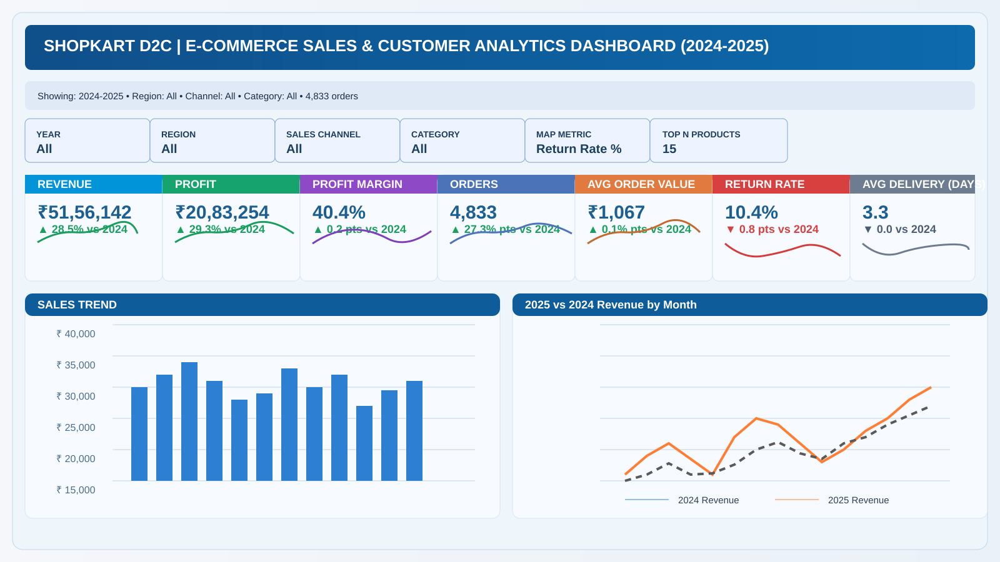

# 🛒 ShopKart E-Commerce Sales Analytics

A complete executive-level sales and customer analytics project for a direct-to-consumer (D2C) retail brand. This project is built in Microsoft Excel and demonstrates how to convert raw ecommerce data into a polished dashboard for business decision-making.

## 🎯 Project Objective
ShopKart sells across multiple channels including Amazon, Flipkart, Myntra, Nykaa, and its own website. The goal of this project is to analyze sales performance, customer retention, return trends, channel profitability, and regional demand using Excel-based analytical tools.

## 📌 Business Questions Covered
- Which sales channels generate the highest revenue?
- Which product categories perform best?
- Which regions contribute most to total sales?
- How do repeat customers compare with first-time customers?
- What is the impact of marketing spend on revenue?
- How do logistics timelines affect returns and satisfaction?
- Which products and markets should get more investment?

## 🛠️ Tools & Skills Used
- Microsoft Excel
- Power Query
- Pivot Tables
- Data Modeling
- Excel Formulas & Functions
- Charts & Dashboard Design
- Conditional Formatting
- KPI Dashboard Design
- Business Analysis

## 📊 Key Features of the Project
- Executive dashboard with KPI cards
- Revenue analysis by channel, category, and region
- Customer retention and repeat purchase tracking
- Product performance ranking
- Regional sales comparison
- Marketing ROI and revenue trend analysis
- Dynamic filters for year, region, channel, and category
- Interactive business reporting format

## 🖼️ Dashboard Preview



## 📁 Repository Contents
- `Ecommerce_Sales_Data_Analyst_Project.xlsx` — main Excel workbook with dashboard and analysis sheets
- `RAW_Ecommerce_Sales_Data.xlsx` — raw ecommerce dataset used for analysis
- `README.md` — project overview and usage documentation

## 🔍 How to Use This Project
1. Download `Ecommerce_Sales_Data_Analyst_Project.xlsx`
2. Open it in Microsoft Excel (preferably Microsoft 365)
3. Go to the `Dashboard` tab to view the summary report
4. Use the filters to switch between year, region, channel, and category
5. Review KPI cards and charts to understand performance trends

## 📈 Business Insights Included
- Top-performing sales channels contribute the most to net revenue
- Apparel and footwear dominate total sales volume
- Regional market differences influence purchasing behavior
- Repeat customers and retention trends affect long-term profitability
- Marketing spend sensitivity can be evaluated using trend and regression analysis

## 💡 Why This Project is Valuable
This project reflects real business analysis work using Excel. It is useful for:
- portfolio building
- business reporting presentations
- understanding ecommerce KPIs
- demonstrating Excel analytics capability
- showcasing dashboard creation and data storytelling skills

## 🧭 Project Structure
```text
ShopKart-ECommerce-Sales-Analytics/
├── Ecommerce_Sales_Data_Analyst_Project.xlsx
├── RAW_Ecommerce_Sales_Data.xlsx
├── README.md
└── assets/
    └── shopkart-dashboard-preview.svg
```

## 🏁 Final Note
This project is a strong example of how Excel can be used for modern business analytics and reporting. It combines practical data handling, dashboard design, business insight generation, and presentation-ready reporting in a single portfolio project.

---

If you want, I can also create a second version of this README in a more polished, recruiter-style format with badges and a stronger portfolio look.
